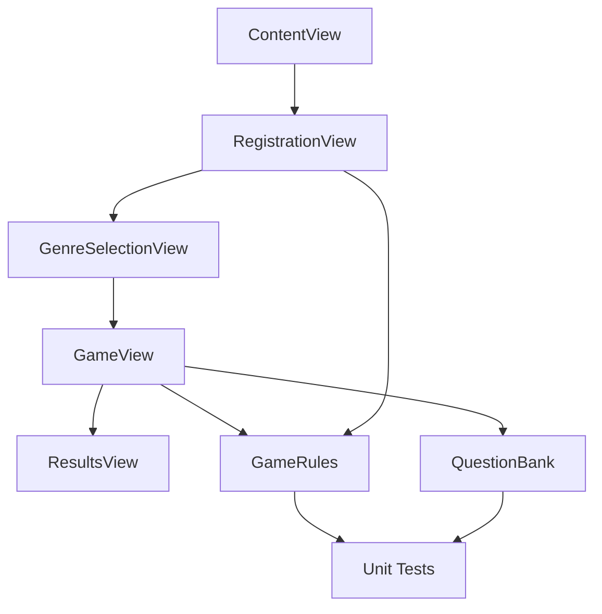

# MillionaireGame

[](https://github.com/Amartya2001-droid/MillionaireGame/actions/workflows/ios-build.yml)

MillionaireGame is a SwiftUI iOS quiz app inspired by "Who Wants to Be a Millionaire?".

## Current status

- Implemented: five genres with 15 questions each, a 15-step prize ladder, three 50:50 hints per run, timed questions, and local best-winnings storage.
- Registration details stay in memory; there is no account service or server leaderboard. Prizes are game scores, not real-money payouts.
- Live URL: **not live yet — blocked by an iOS distribution/release setup**. No App Store or TestFlight URL is recorded in this repository.
- Latest main (`4a11c3b`) has a [successful iOS Build run](https://github.com/Amartya2001-droid/MillionaireGame/actions/runs/24931406309), completed April 25, 2026. This is an existing run, not a fresh Day 1 build.
- Question timers use wall-clock deadlines: elapsed time continues while the app is backgrounded, and expiry is checked before answers or hints. System clock changes affect these deadlines.
- Linux can run the Foundation logic tests below. It cannot build SwiftUI iOS code or verify simulator UI, device behavior, signing, or distribution; those require macOS/Xcode.

## Highlights

- Built with SwiftUI for iOS
- Clean navigation from landing page to registration, genre selection, gameplay, and results
- Time-based progression with a 15-question prize ladder
- 50:50 hint mechanic and local best-score persistence
- Extracted game rules for testable business logic
- GitHub Actions workflow that builds and tests the app on macOS

## Tech Stack

- Swift
- SwiftUI
- XCTest
- Xcode
- GitHub Actions

## Architecture



## Project Structure

- `MillionaireGame/ContentView.swift`
  Entry point for the landing screen and app navigation.
- `MillionaireGame/GameFlowViews.swift`
  Registration, genre selection, gameplay, results, and instructions.
- `MillionaireGame/GameRules.swift`
  Pure game-logic helpers for validation, timing, and hint reduction.
- `MillionaireGame/Models.swift`
  Core domain models such as `PlayerProfile`, `GameQuestion`, and `GameOutcome`.
- `MillionaireGame/QuestionBank.swift`
  Quiz data and prize ladder configuration.
- `MillionaireGame/DesignSystem.swift`
  Shared visual styling, button styles, and UI helpers.
- `MillionaireGameTests/MillionaireGameTests.swift`
  Unit tests for core game logic.
- `.github/workflows/ios-build.yml`
  GitHub Actions workflow for simulator builds and tests.

## Gameplay

1. Start from the home screen.
2. Enter player details.
3. Choose a quiz genre.
4. Answer 15 questions against the clock.
5. Use up to three 50:50 hints strategically.
6. Finish the ladder and aim for the top prize.

## What I Focused On

- Breaking a prototype-style codebase into focused files
- Keeping UI code readable while moving rules into testable logic
- Making the repository presentable and verifiable on GitHub
- Using CI so the project shows build discipline even without local Xcode installed

## Running Locally

### Requirements

- macOS
- Full Xcode installation
- iOS Simulator or physical Apple device

### Setup

```bash
git clone https://github.com/Amartya2001-droid/MillionaireGame.git
cd MillionaireGame
open MillionaireGame.xcodeproj
```

Choose a simulator in Xcode and run with `Cmd + R`.

## Automated Verification

The repository includes a GitHub Actions workflow that:

- Selects Xcode on a macOS runner
- Builds the app for iOS Simulator
- Runs the unit test suite

For portable logic verification with Swift 5.9 or later:

```bash
swift test
```

This runs the same XCTest source against `GameRules`, `Models`, and `QuestionBank`.
It does not build or exercise the SwiftUI screens. Use the macOS workflow for the full app build and hosted iOS tests.

## Future Improvements

- Add richer game audio and motion feedback
- Expand the question bank and difficulty scaling
- Add accessibility improvements and voice guidance
- Add screenshot assets or a demo video for the README

## License

No license has been added yet.
